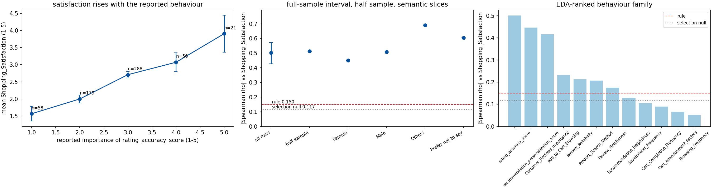

# 01_profile

## question

Does the reported importance of rating_accuracy_score track Shopping_Satisfaction beyond the selection-adjusted no-effect null?

## decision — act

- metric: satisfaction_rating_accuracy_rho = 0.5015 [0.4275, 0.5729] 95% (n=602, unit=abs_spearman_rho)
- rule: max 0.1500 (permutation null 0.1166)
- reference: 0.0000 (delta +0.5015)
- action (amazon_survey): treat rating accuracy as a candidate satisfaction driver and re-check it in a held-out model before the storefront acts on it

## evidence

- baseline: no-effect permutation of Shopping_Satisfaction over the whole 12-feature family (max |rho| at this n)

### segments

| segment | value | n |
| --- | ---: | ---: |
| Female | 0.4512 | 352 |
| Male | 0.5082 | 142 |
| Others | 0.6910 | 19 |
| Prefer not to say | 0.6040 | 89 |

### sensitivity

- rho_half_sample_n301: 0.5123
- family_max_rho_null_q0.95_n602: 0.1166
- kendall_tau_abs_n602: 0.4502

### falsifier

the interval's lower bound falls at or below the selection-adjusted null 0.117 — the feature would then be indistinguishable from a Shopping_Satisfaction shuffle over the same family

### provenance

- dataset: amazon
- artifact: data/processed/amazon/amazon_canonical.parquet
- artifact_sha256: 3e272609e12e628e
- source: data/raw/amazon/amazon_consumer_behavior_survey.csv
- rows: 602
- seed: 42
- resampling: iid+shuffle
- selection: family of 12 EDA-ranked features declared in amazon_survey.yaml; the null takes their max |rho|
- segments: levels of Gender
- exclusions: none beyond the pairwise-complete pair and the ETL contract

## tables

- [ranked](01_profile_ranked.csv)
- [segments](01_profile_segments.csv)
