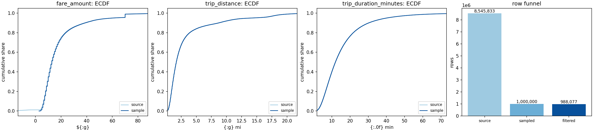

# 01_generate_sample

## question

Did sampling plus the fare policy preserve the source population?

## decision — act

- metric: ks_fare_amount = 0.0136 [0.0121, 0.0164] 95% (n=50,000)
- rule: max 0.0100 (permutation null 0.0075)
- action (fare_prediction): review the fare-policy exclusion before training

## evidence

- baseline: no-effect permutation (sample labels shuffled at this n)

### segments

| segment | value | n |
| --- | ---: | ---: |
| weekday | 0.0117 | 50,000 |
| weekend | 0.0129 | 50,000 |

### sensitivity

- ks_half_sample: 0.0118
- ks_seed_7: 0.0136

### falsifier

the KS interval no longer clears the null band once the fare-policy exclusions are relaxed

### provenance

- artifact: fare_prediction_1m
- artifact_sha256: 158940b0d905b77d53f94cb849fffdff068958db642a7bbd19074a742a8aed67
- source: data/processed/training_data.parquet
- seed: 42
- draw_seed: 42
- exclusions: fare<=4.40 with long distance/duration/speed

## tables

- [columns](01_generate_sample_columns.csv)
- [funnel](01_generate_sample_funnel.csv)
