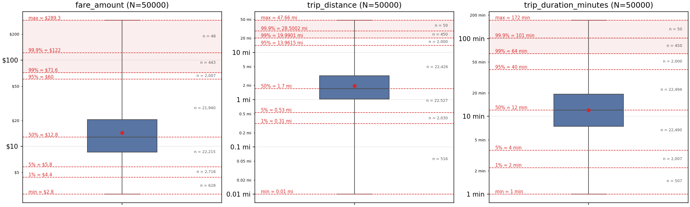

# 02_filtered_profile

## question

Is the fare surface spread widely enough to need a transformed target?

## decision — act

- metric: fare_p99_over_p1 = 16.2727 [15.9091, 16.7525] 95% (n=50,000, unit=ratio)
- rule: max 10.0000
- action (fare_prediction): model fare on the log-target and report error by fare band

## evidence

- baseline: uniform-spread reference: p99/p01 ratio of 10

### segments

| segment | value | n |
| --- | ---: | ---: |
| weekday | 16.2727 | 36,195 |
| weekend | 16.2727 | 13,805 |

### sensitivity

- p999_over_p001_n50000: 32.9730
- p95_over_p05_n50000: 10.3448

### falsifier

the 95% interval of the p99/p01 ratio falls below the 10x floor

### provenance

- artifact: fare_prediction_1m
- artifact_sha256: 158940b0d905b77d53f94cb849fffdff068958db642a7bbd19074a742a8aed67
- seed: 42
- analysis_sample: 50000
- block: day
- resampling: block
- exclusions: fare policy + plausibility exclusions in the sample registry

## tables

- [describe](02_filtered_profile_describe.csv)
