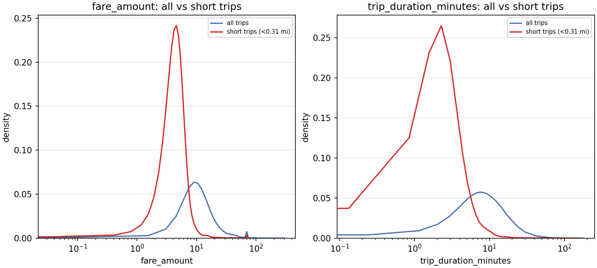

# 03_short_trips

## question

Are short trips a material slice that deserves its own error read?

## decision — no_action

- metric: short_trip_share = 0.0095 [0.0087, 0.0104] 95% (n=50,000, unit=share)
- rule: max 0.0200
- action (fare_prediction): keep the short-trip slice visible in the error analysis

## evidence

- baseline: zero short-trip mass (the slice is absent from the sample)

### segments

| segment | value | n |
| --- | ---: | ---: |
| weekday | 0.0096 | 36,195 |
| weekend | 0.0094 | 13,805 |

### sensitivity

- share_under_0_5_mi_n50000: 0.0370
- share_under_0_2_mi_n50000: 0.0020

### falsifier

the 95% interval of the short-trip share falls below the 2% floor

### provenance

- artifact: fare_prediction_1m
- artifact_sha256: 158940b0d905b77d53f94cb849fffdff068958db642a7bbd19074a742a8aed67
- seed: 42
- analysis_sample: 50000
- block: day
- resampling: block
- exclusions: distance floor 0.31 mi applied for the slice only

## tables

- [describe](03_short_trips_describe.csv)
