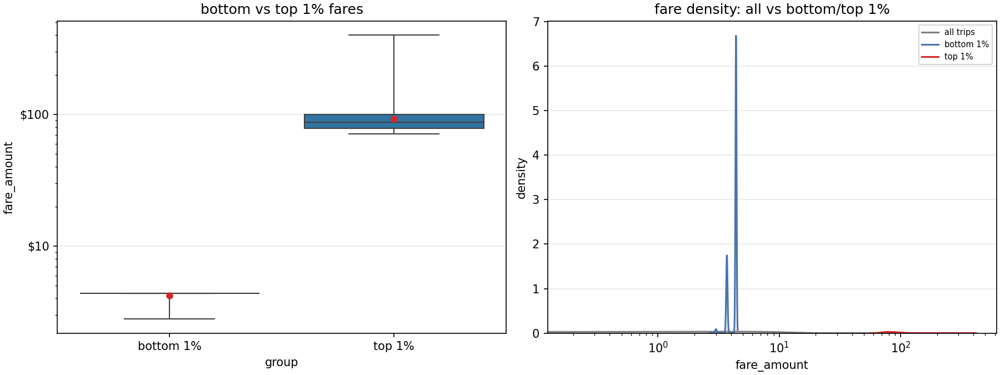

# 04_percentile_extremes_audit

## question

Are the fare extremes plausible after the policy?

## decision — act

- metric: plausible_extreme_share = 0.9998 [0.9996, 1.0000] 95% (n=22,999, unit=share)
- rule: max 0.9500 (permutation null 0.5526)
- action (fare_prediction): keep the current plausibility exclusions

## evidence

- baseline: plausible extremes (no implausible trip in the bottom/top 1%)

### segments

| segment | value | n |
| --- | ---: | ---: |
| bottom_1pct | 1.0000 | 12,946 |
| top_1pct | 0.9996 | 10,053 |

### sensitivity

- plausible_share_at_40mph_cap_n22999: 0.9346
- plausible_share_second_seed_n11499: 0.9998

### falsifier

the plausible-share interval falls below the 95% floor

### provenance

- artifact: fare_prediction_1m
- artifact_sha256: 158940b0d905b77d53f94cb849fffdff068958db642a7bbd19074a742a8aed67
- seed: 42
- analysis_sample: 22999
- block: day
- resampling: block+block_shuffle
- exclusions: bottom/top 1% quantile cut at the measured fare

## tables

- [describe](04_percentile_extremes_audit_describe.csv)
