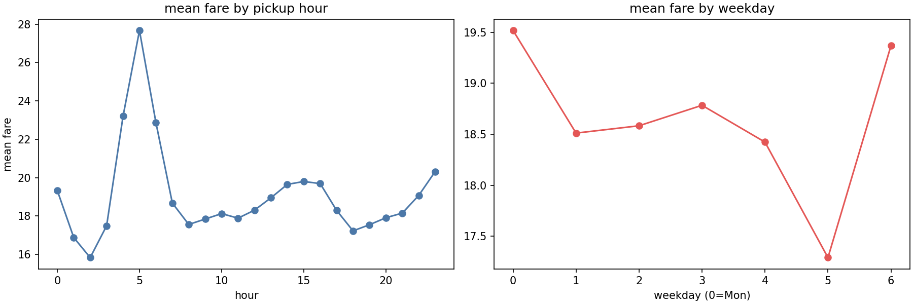

# 05_temporal_features

## question

Does pickup time carry fare signal worth keeping in the model?

## decision — no_action

- metric: fare_hour_eta_squared = 0.0045 [0.0039, 0.0065] 95% (n=50,000, unit=variance_share)
- rule: max 0.0100 (permutation null 0.0007)
- action (fare_prediction): review whether the temporal features earn their keep in the model

## evidence

- baseline: no temporal signal: fare variance is unrelated to pickup hour

### segments

| segment | value | n |
| --- | ---: | ---: |
| weekday | 0.0063 | 36,195 |
| weekend | 0.0101 | 13,805 |

### sensitivity

- day_of_week_eta_squared_n50000: 0.0016
- hour_eta_squared_weekday_n36195: 0.0063
- hour_eta_squared_second_seed_n25000: 0.0052

### falsifier

the hour eta squared interval falls below the 1% variance floor

### provenance

- artifact: fare_prediction_1m
- artifact_sha256: 158940b0d905b77d53f94cb849fffdff068958db642a7bbd19074a742a8aed67
- seed: 42
- analysis_sample: 50000
- block: day
- resampling: block+block_shuffle
- exclusions: temporal flags and cyclical encodings from the shared recipe

## tables

- [features](05_temporal_features_features.csv)
- [describe](05_temporal_features_describe.csv)
