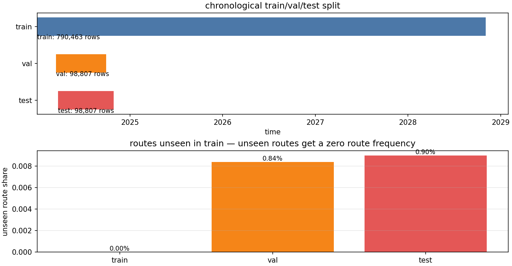

# 06_prepare_model_data

## question

Does the chronological split leave the test slice inside the train route frequency?

## decision — act

- metric: test_unseen_route_share = 0.0088 [0.0080, 0.0096] 95% (n=50,000, unit=share)
- rule: min 0.0500
- action (fare_prediction): ship the chronological split as-is

## evidence

- baseline: every test route seen in train (unseen share of zero)

### segments

| segment | value | n |
| --- | ---: | ---: |
| repeated_train_routes | 0.0000 | 49,286 |
| rare_or_unseen_train_routes | 0.6190 | 714 |

### sensitivity

- val_unseen_route_share_n98807: 0.0084
- unseen_route_share_second_seed_n25000: 0.0098

### falsifier

the unseen-route interval exceeds the 5% ceiling

### provenance

- artifact: fare_prediction_1m
- artifact_sha256: 158940b0d905b77d53f94cb849fffdff068958db642a7bbd19074a742a8aed67
- version: v3
- seed: 42
- analysis_sample: 50000
- block: day
- resampling: block
- exclusions: route frequency fitted on the chronological train slice only

## tables

- [split](06_prepare_model_data_split.csv)
