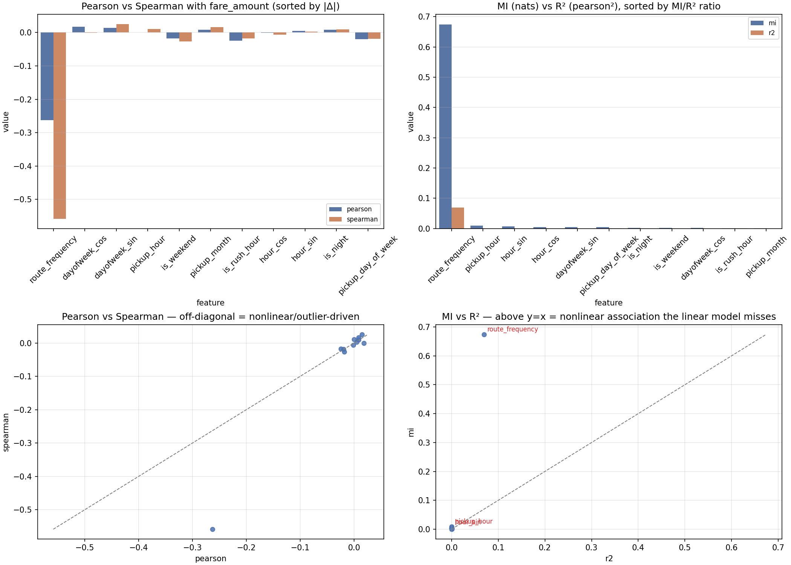

# 07_specification_diagnostics

## question

Does a linear reading of the safe features hide nonlinearity?

## decision — act

- metric: top_pearson_spearman_delta = 0.2941 [0.2882, 0.3015] 95% (n=50,000, unit=correlation_gap)
- rule: max 0.0500 (permutation null 0.0096)
- action (fare_prediction): add the nonlinear transform for the flagged feature before modeling

## evidence

- baseline: linear reading sufficient: Pearson equals Spearman on every feature

### segments

| segment | value | n |
| --- | ---: | ---: |
| weekday | 0.2872 | 36,757 |
| weekend | 0.3165 | 13,243 |

### sensitivity

- top_mi_r2_ratio_n50000: 7.5281
- top_delta_second_seed_n25000: 0.2971
- reset_power2_p_value_n50000: 0.0000

### falsifier

every |Pearson - Spearman| gap falls below 0.05

### provenance

- artifact: train.parquet
- source: /home/opc/ONE/broad-way/project/experiments/results/fare_prediction/prepared/train.parquet
- seed: 42
- analysis_sample: 50000
- block: day
- resampling: block+block_shuffle
- exclusions: post-trip columns (distance/duration/speed) excluded as leakage

## tables

- [describe](07_specification_diagnostics_describe.csv)
- [reset](07_specification_diagnostics_reset.csv)
