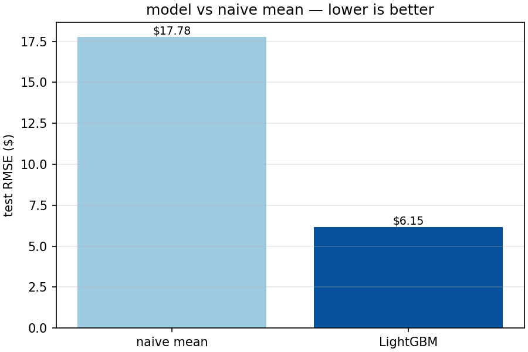

# 08_lightgbm_baseline

## question

Does the baseline model beat the naive mean out of sample?

## decision — act

- metric: rmse_improvement_vs_mean = 0.6593 [0.6355, 0.6802] 95% (n=50,000, unit=relative_improvement)
- rule: max 0.0500 (permutation null -0.3544)
- action (fare_prediction): adopt the LightGBM baseline as the reference model

## evidence

- baseline: naive train-mean prediction (the model must beat it out of sample)

### segments

| segment | value | n |
| --- | ---: | ---: |
| weekday | 0.6634 | 29,695 |
| weekend | 0.6536 | 20,305 |

### sensitivity

- mae_improvement_n50000: 0.7432
- val_improvement_n98807: 0.6586
- improvement_second_seed_n25000: 0.6461

### falsifier

the RMSE-improvement interval falls below the 5% floor on test

### provenance

- artifact: lgbm_baseline.txt
- source: prepared
- seed: 42
- analysis_sample: 50000
- block: day
- resampling: block+block_shuffle
- exclusions: post-trip columns (distance/duration/speed) excluded as leakage

## tables

- [describe](08_lightgbm_baseline_describe.csv)
- [importance](08_lightgbm_baseline_importance.csv)
