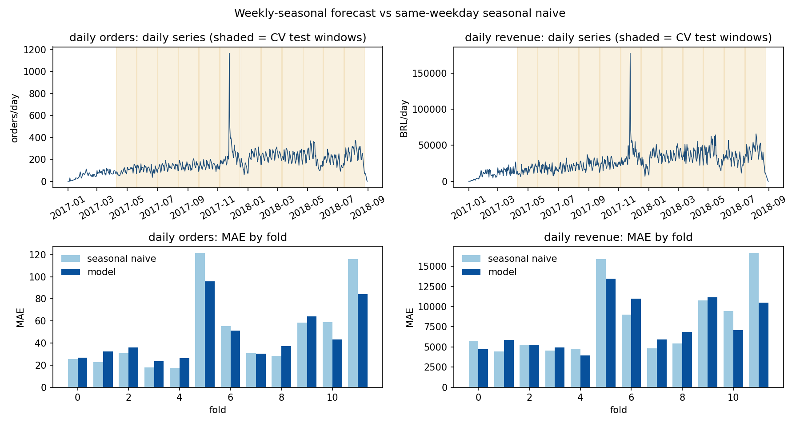
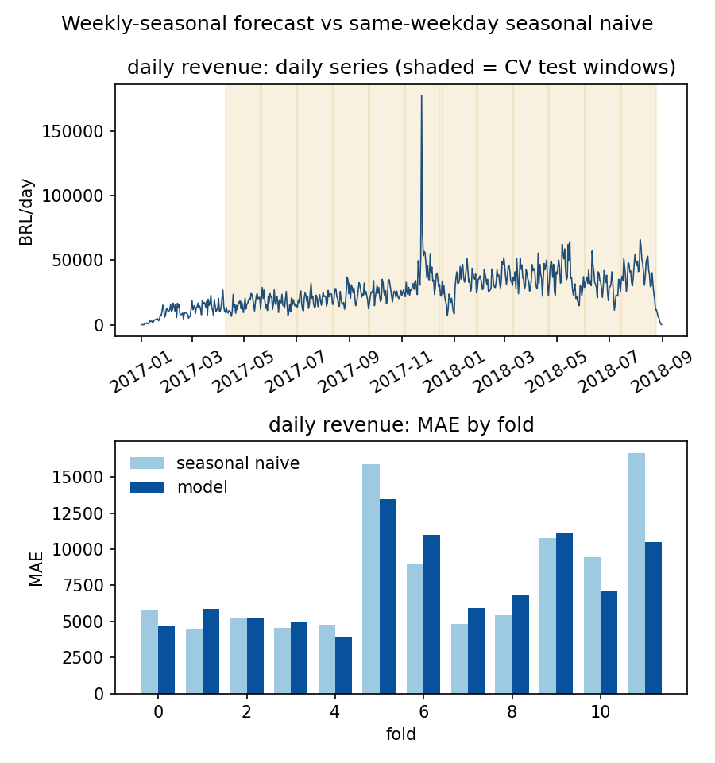

# 08_timeseries

## question

Does a weekly-seasonal forecast beat a same-weekday seasonal-naive baseline on the daily series (daily orders, daily revenue)?

## decision

| series | metric | value | 95% interval | null | n | verdict |
| --- | --- | ---: | ---: | ---: | ---: | --- |
| orders | relative_mae_improvement | -0.0843 | [-0.2284, 0.0626] | 0.0466 | 504 | investigate |
| revenue | relative_mae_improvement | -0.0025 | [-0.1249, 0.1215] | 0.0472 | 504 | investigate |

## method

- grain: one canonical row per `order_id`; a count series counts rows per day, a sum series sums its declared column per day
- datetime source: `order_purchase_timestamp` in the canonical table (the dataset contract's `datetime_column` is null; the timestamp is context, not a model feature)
- window: 2017-01-01 to 2018-08-31 (inclusive), one value per calendar day; days with no rows are zero-filled
- sparse/partial handling: 2016-09 is the launch month (4 orders on its first day) and 2016-11 has no orders, so the series starts at 2017-01-01 to estimate a weekly cycle on complete months. The 2018-09/10 tail is partial (16 and 4 orders), so 2018-08-31 is the final complete day and the tail is excluded.
- baseline first: same-weekday seasonal naive (lag 7), recursive over each test block
- model: auto_arima, weekly seasonality (season length 7), alpha=0.05
- CV: expanding forward chaining, 12 folds, whole 7-day cycles, gap 0; no shuffled or single split
- interval: seeded fold-level percentile bootstrap (2000 draws, seed 2026, level 0.95); each fold is one evidence unit, so a high-volume fold cannot dominate the headline
- null: seeded paired swap of each day's model/baseline absolute errors within its fold, then the mean across folds (2000 draws, seed 2026)

## baseline vs model

| series | baseline MAE | model MAE | mean fold improvement | fold spread |
| --- | ---: | ---: | ---: | ---: |
| orders | 48.6865 | 45.9597 | -0.0843 | 0.2636 |
| revenue | 8,069.3341 | 7,560.1321 | -0.0025 | 0.2278 |

## cross-validation folds

| series | fold | train | test | test n | baseline MAE | model MAE | improvement |
| --- | ---: | --- | --- | ---: | ---: | ---: | ---: |
| orders | 1 | 2017-01-01 → 2017-04-08 | 2017-04-09 → 2017-05-20 | 42 | 25.6667 | 26.7888 | -0.0437 |
| orders | 2 | 2017-01-01 → 2017-05-20 | 2017-05-21 → 2017-07-01 | 42 | 22.7619 | 32.2307 | -0.4160 |
| orders | 3 | 2017-01-01 → 2017-07-01 | 2017-07-02 → 2017-08-12 | 42 | 30.9286 | 35.9502 | -0.1624 |
| orders | 4 | 2017-01-01 → 2017-08-12 | 2017-08-13 → 2017-09-23 | 42 | 17.8095 | 23.4229 | -0.3152 |
| orders | 5 | 2017-01-01 → 2017-09-23 | 2017-09-24 → 2017-11-04 | 42 | 17.6429 | 26.5346 | -0.5040 |
| orders | 6 | 2017-01-01 → 2017-11-04 | 2017-11-05 → 2017-12-16 | 42 | 121.5000 | 95.9675 | +0.2101 |
| orders | 7 | 2017-01-01 → 2017-12-16 | 2017-12-17 → 2018-01-27 | 42 | 55.1190 | 51.4442 | +0.0667 |
| orders | 8 | 2017-01-01 → 2018-01-27 | 2018-01-28 → 2018-03-10 | 42 | 30.7381 | 30.4062 | +0.0108 |
| orders | 9 | 2017-01-01 → 2018-03-10 | 2018-03-11 → 2018-04-21 | 42 | 28.4524 | 37.1236 | -0.3048 |
| orders | 10 | 2017-01-01 → 2018-04-21 | 2018-04-22 → 2018-06-02 | 42 | 58.5952 | 63.9929 | -0.0921 |
| orders | 11 | 2017-01-01 → 2018-06-02 | 2018-06-03 → 2018-07-14 | 42 | 58.9762 | 43.3316 | +0.2653 |
| orders | 12 | 2017-01-01 → 2018-07-14 | 2018-07-15 → 2018-08-25 | 42 | 116.0476 | 84.3233 | +0.2734 |
| revenue | 1 | 2017-01-01 → 2017-04-08 | 2017-04-09 → 2017-05-20 | 42 | 5,753.5248 | 4,709.0020 | +0.1815 |
| revenue | 2 | 2017-01-01 → 2017-05-20 | 2017-05-21 → 2017-07-01 | 42 | 4,460.7171 | 5,895.5367 | -0.3217 |
| revenue | 3 | 2017-01-01 → 2017-07-01 | 2017-07-02 → 2017-08-12 | 42 | 5,284.1550 | 5,259.7639 | +0.0046 |
| revenue | 4 | 2017-01-01 → 2017-08-12 | 2017-08-13 → 2017-09-23 | 42 | 4,554.2379 | 4,944.1199 | -0.0856 |
| revenue | 5 | 2017-01-01 → 2017-09-23 | 2017-09-24 → 2017-11-04 | 42 | 4,748.9993 | 3,940.6165 | +0.1702 |
| revenue | 6 | 2017-01-01 → 2017-11-04 | 2017-11-05 → 2017-12-16 | 42 | 15,908.4219 | 13,468.4342 | +0.1534 |
| revenue | 7 | 2017-01-01 → 2017-12-16 | 2017-12-17 → 2018-01-27 | 42 | 9,028.7562 | 10,981.5070 | -0.2163 |
| revenue | 8 | 2017-01-01 → 2018-01-27 | 2018-01-28 → 2018-03-10 | 42 | 4,807.1029 | 5,930.4043 | -0.2337 |
| revenue | 9 | 2017-01-01 → 2018-03-10 | 2018-03-11 → 2018-04-21 | 42 | 5,420.4062 | 6,869.2556 | -0.2673 |
| revenue | 10 | 2017-01-01 → 2018-04-21 | 2018-04-22 → 2018-06-02 | 42 | 10,746.5624 | 11,147.2874 | -0.0373 |
| revenue | 11 | 2017-01-01 → 2018-06-02 | 2018-06-03 → 2018-07-14 | 42 | 9,464.9193 | 7,065.2701 | +0.2535 |
| revenue | 12 | 2017-01-01 → 2018-07-14 | 2018-07-15 → 2018-08-25 | 42 | 16,654.2062 | 10,510.3882 | +0.3689 |

## evidence

| series | slice / check | value | n |
| --- | --- | ---: | ---: |
| orders | segment: weekday | -0.0054 | 360 |
| orders | segment: weekend | -0.4081 | 144 |
| orders | sensitivity: pooled_relative_improvement | +0.0560 | — |
| orders | sensitivity: rmse_relative_improvement | +0.0808 | — |
| orders | sensitivity: first_week_relative_improvement | -0.0124 | — |
| revenue | segment: weekday | +0.1055 | 360 |
| revenue | segment: weekend | -0.4080 | 144 |
| revenue | sensitivity: pooled_relative_improvement | +0.0631 | — |
| revenue | sensitivity: rmse_relative_improvement | +0.0615 | — |
| revenue | sensitivity: first_week_relative_improvement | +0.1351 | — |

## figures

