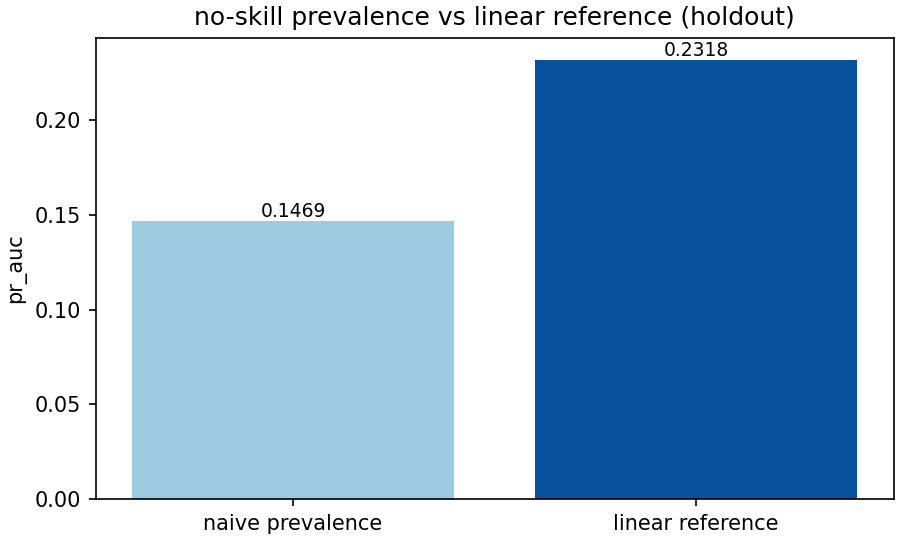

# baseline

## question

Does the linear reference beat the naive mean on the holdout?

## decision — act

- metric: improvement_over_naive_mae = 0.2861 [0.1737, 0.3933] 95% (n=121, unit=relative_improvement)
- rule: max 0.0200
- action (amazon): treat the naive mean as the bar the champion must clear on the holdout

## evidence

- baseline: naive training-mean predictor on the holdout rows
- delta vs baseline: +0.2861

### segments

| segment | value | n |
| --- | ---: | ---: |
| first_half | 0.3438 | 60 |
| second_half | 0.2305 | 61 |

### sensitivity

- level_90pct_low: 0.1637
- level_90pct_high: 0.3207
- naive_mae_n121: 0.8518
- linear_mae_n121: 0.6081

### falsifier

the linear reference's paired MAE improvement interval falls at or below the configured effect floor

### provenance

- dataset: amazon
- target: ordinal 1-5 treated as interval-scale
- artifact: baseline.json
- seed: 7
- rows: 121
- resampling: paired row bootstrap on the holdout

## tables

- none
