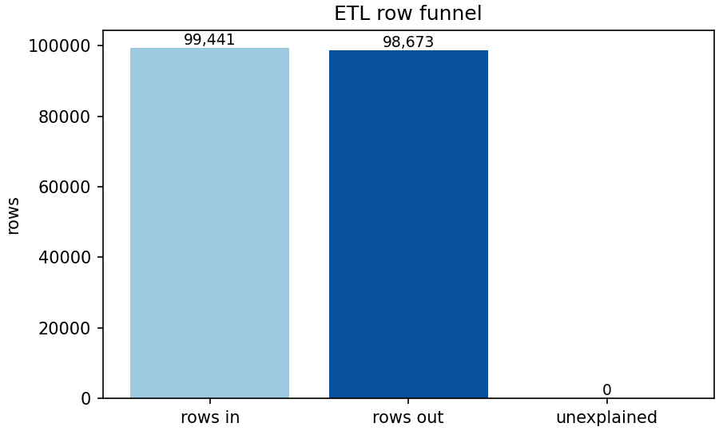

# etl

## question

Did the ingest lose more rows than the contract explains?

## decision — no_action

- metric: rows_dropped_unexplained_share = 0.0000 [0.0000, 0.0000] 95% (n=99,441, unit=share)
- rule: max 0.1000
- action (olist): fix the source before training

## evidence

- baseline: contract-clean ingest: every dropped row carries a recorded reason

### segments

| segment | value | n |
| --- | ---: | ---: |
| explained_drops | 0.0077 | 99,441 |
| unexplained_drops | 0.0000 | 99,441 |

### sensitivity

- total_drop_share_n99441: 0.0077
- rows_out_n98673: 98,673.0000

### falsifier

the unexplained-share interval clears the configured drop ceiling

### provenance

- artifact: canonical.parquet
- dataset: olist
- rows_in: 99441
- rows_out: 98673
- reasons: null target: -768 rows

## tables

- none
