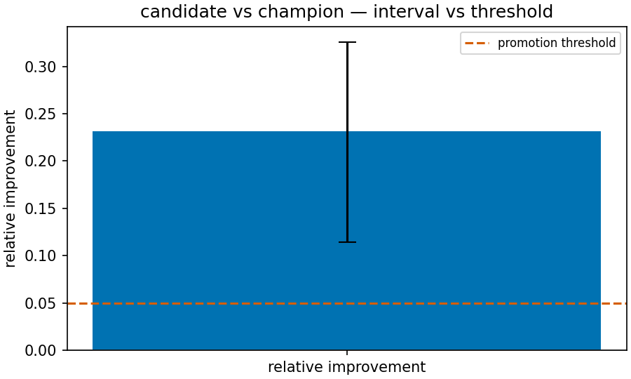

# champion_promotion

## question

Does the candidate beat the champion on rmse by more than 5.0% on the holdout?

## decision — act

- metric: improvement_rmse = 0.2312 [0.1140, 0.3258] 95% (n=121, unit=relative_improvement)
- rule: max 0.0500
- action (amazon): promote the candidate to champion

## evidence

- baseline: champion naive training-mean on the same holdout
- delta vs baseline: +0.2312

### segments

| segment | value | n |
| --- | ---: | ---: |
| first_half | 0.2919 | 60 |
| second_half | 0.1797 | 61 |

### sensitivity

- level_90pct_low: 0.1353
- level_90pct_high: 0.3085
- absolute_improvement_low: 0.1144
- absolute_improvement_high: 0.3269

### falsifier

the 95% improvement interval's lower bound falls below the 5.0% threshold

### provenance

- dataset: amazon
- target: ordinal 1-5 treated as interval-scale
- champion: naive training-mean
- seed: 42
- rows: 121
- resampling: paired row bootstrap on the holdout

## tables

- [values](champion_promotion_values.csv)
