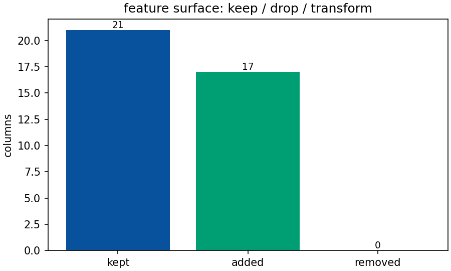

# features

## question

Did the feature step keep every row and the declared feature surface?

## decision — no_action

- metric: row_loss_share = 0.0000 [0.0000, 0.0000] 95% (n=481, unit=share)
- rule: max 0.0000
- action (amazon): fix the feature transform before training

## evidence

- baseline: row-preserving transform (every input row survives)

### segments

| segment | value | n |
| --- | ---: | ---: |
| train_split | 0.0000 | 481 |
| val_split | 0.0000 | 121 |

### sensitivity

- features_added_n481: 17.0000
- features_removed_n481: 0.0000
- plan_columns_n481: 21.0000
- first_half_row_loss_n240: 0.0000

### falsifier

the row-loss interval clears the configured drop ceiling

### provenance

- artifact: feature_pipeline.pkl
- dataset: amazon
- plan_columns: age, Customer_Reviews_Importance, recommendation_personalization_score, rating_accuracy_score, Gender_frequency_enc, Purchase_Frequency_frequency_enc, Purchase_Categories_frequency_enc, Personalized_Recommendation_Frequency_frequency_enc, Browsing_Frequency_frequency_enc, Product_Search_Method_frequency_enc, Search_Result_Exploration_frequency_enc, Add_to_Cart_Browsing_frequency_enc, Cart_Completion_Frequency_frequency_enc, Cart_Abandonment_Factors_frequency_enc, Saveforlater_Frequency_frequency_enc, Review_Left_frequency_enc, Review_Reliability_frequency_enc, Review_Helpfulness_frequency_enc, Recommendation_Helpfulness_frequency_enc, Service_Appreciation_frequency_enc, Improvement_Areas_frequency_enc
- columns_added: Add_to_Cart_Browsing_frequency_enc, Browsing_Frequency_frequency_enc, Cart_Abandonment_Factors_frequency_enc, Cart_Completion_Frequency_frequency_enc, Gender_frequency_enc, Improvement_Areas_frequency_enc, Personalized_Recommendation_Frequency_frequency_enc, Product_Search_Method_frequency_enc, Purchase_Categories_frequency_enc, Purchase_Frequency_frequency_enc, Recommendation_Helpfulness_frequency_enc, Review_Helpfulness_frequency_enc, Review_Left_frequency_enc, Review_Reliability_frequency_enc, Saveforlater_Frequency_frequency_enc, Search_Result_Exploration_frequency_enc, Service_Appreciation_frequency_enc
- columns_removed: none

## tables

- none
