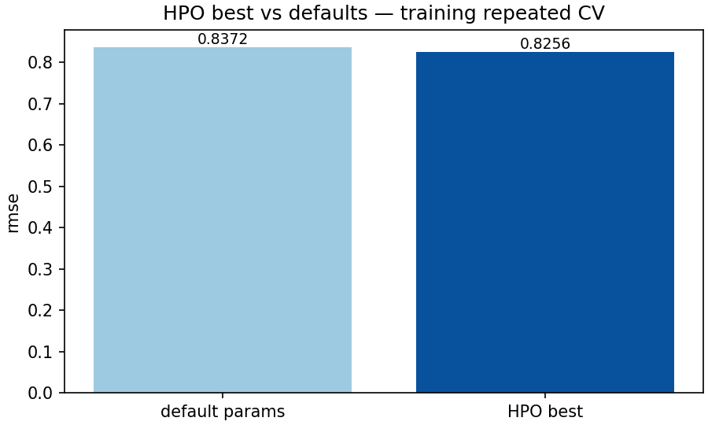

# hpo

## question

Do the HPO-best params beat the declared defaults on training-only repeated CV?

## decision — investigate

- metric: improvement_over_default_rmse = 0.0142 [0.0096, 0.0186] 95% (n=481, unit=relative_improvement)
- rule: max 0.0100
- action (amazon): adopt the HPO-best params for the tuned champion

## evidence

- baseline: the experiment's default params on the identical HPO folds
- delta vs baseline: +0.0142

### segments

| segment | value | n |
| --- | ---: | ---: |
| low_target_half | 0.0259 | 253 |
| high_target_half | 0.0130 | 228 |

### sensitivity

- second_seed_improvement_seed99: 0.0094
- best_cv_rmse_n481: 0.8256
- default_cv_rmse_n481: 0.8372

### falsifier

the paired best-vs-default interval's lower bound falls at or below the configured effect floor

### provenance

- dataset: amazon
- seed: 7
- folds: 3x5 shuffled KFold (HPO seed)
- trials: 40
- model: rf
- best_params: {'n_estimators': 570, 'max_depth': 14, 'min_samples_leaf': 2, 'min_samples_split': 5, 'max_samples': 0.5416264327961499}
- resampling: paired fold bootstrap

## tables

- [folds](hpo_folds.csv)
