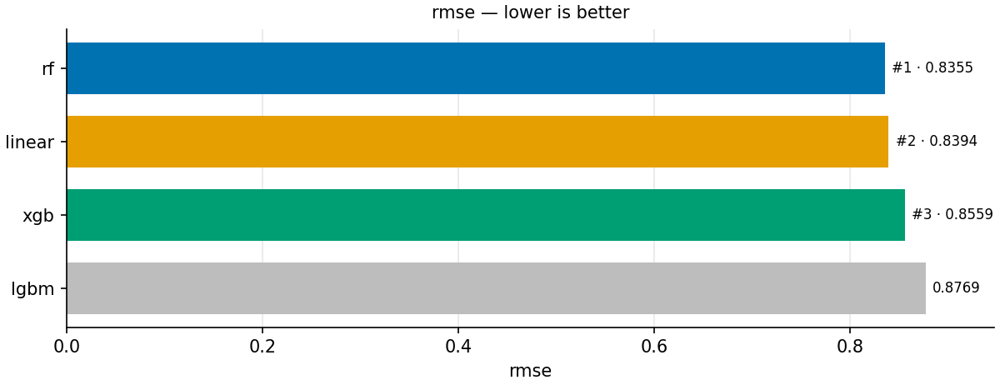

# selection

## question

Does the selected rmse champion beat the naive reference on identical repeated folds?

## decision — act

- metric: improvement_over_naive_rmse = 0.1748 [0.1492, 0.1980] 95% (n=481, unit=relative_improvement)
- rule: max 0.0200
- action (amazon): carry the selected champion into HPO and a holdout promotion check

## evidence

- baseline: naive training-mean predictor 'naive_mean' on the identical 5x5 shuffled folds
- delta vs baseline: +0.1748

### segments

| segment | value | n |
| --- | ---: | ---: |
| low_target_half | 0.1835 | 253 |
| high_target_half | 0.1960 | 228 |

### sensitivity

- second_seed_improvement_seed77: 0.1836
- linear_reference_improvement_rmse: 0.1709
- champion_cv_rmse_n481: 0.8355
- naive_cv_rmse_n481: 1.0134

### falsifier

the paired improvement interval's lower bound falls at or below the configured effect floor

### provenance

- dataset: amazon
- seed: 2026
- folds: 5x5 shuffled KFold
- candidates: naive_mean, linear, rf, lgbm, xgb
- champion_params: {'n_estimators': 300, 'min_samples_leaf': 2}
- resampling: paired fold bootstrap

## tables

- [candidates](selection_candidates.csv)
