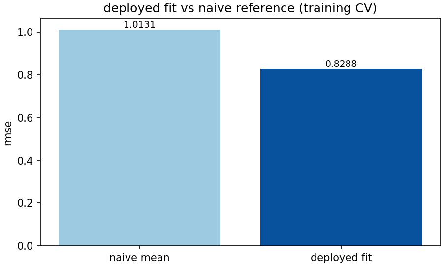

# training

## question

Does the deployed fit beat the naive reference on training-only CV?

## decision — act

- metric: improvement_over_naive_rmse = 0.1892 [0.1366, 0.2433] 95% (n=481, unit=relative_improvement)
- rule: max 0.0200
- action (amazon): deploy the fitted model behind the evaluate promotion gate

## evidence

- baseline: naive training-mean predictor on the identical shuffled folds
- delta vs baseline: +0.1892

### segments

| segment | value | n |
| --- | ---: | ---: |
| low_target_half | 0.1734 | 253 |
| high_target_half | 0.2031 | 228 |

### sensitivity

- level_90pct_low: 0.1462
- level_90pct_high: 0.2335
- fitted_cv_rmse_n481: 0.8288
- naive_cv_rmse_n481: 1.0131

### falsifier

the paired improvement interval's lower bound falls at or below the configured effect floor

### provenance

- dataset: amazon
- target: ordinal 1-5 treated as interval-scale
- seed: 4242
- folds: 5x5 shuffled KFold
- params: {'n_estimators': 300, 'min_samples_leaf': 2}
- resampling: paired row bootstrap on out-of-fold predictions

## tables

- none
