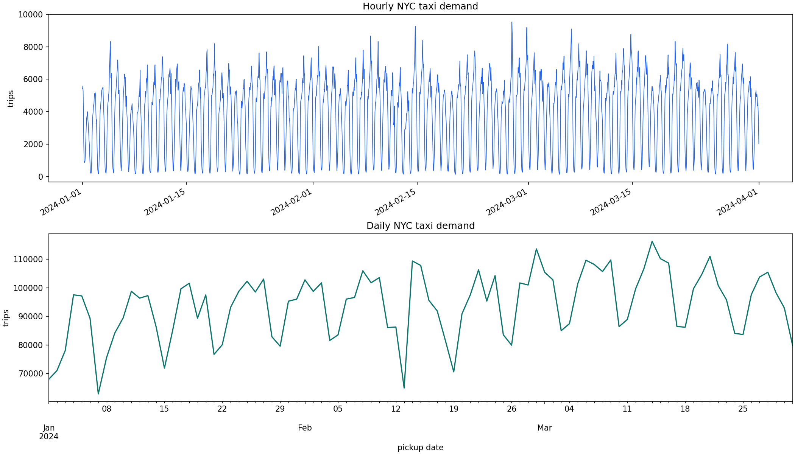

# 01_series_profile

## question

Is the canonical frame contiguous enough for lag features?

## decision — no_action

- metric: missing_hour_share = 0.0005 [0.0000, 0.0014] 95% (n=2,185, unit=share)
- rule: max 0.0100
- action (timeseries): repair the gaps or shorten the forecast horizon to the contiguous block

## evidence

- baseline: a complete hourly grid (every expected hour observed)

### segments

| segment | value | n |
| --- | ---: | ---: |
| first_half | 0.0000 | 1,104 |
| second_half | 0.0009 | 1,081 |

### sensitivity

- missing_hours: 1.0000
- expected_hours: 2,185.0000

### falsifier

the missing-hour share interval exceeds the 1% ceiling

### provenance

- artifact: taxi_canonical.parquet
- source: data/processed/taxi_canonical.parquet
- seed: 42
- analysis_sample: 2185
- block: day
- resampling: block
- exclusions: partial terminal hour/day retained in tables, excluded from plots

## tables

- [hourly_counts](01_series_profile_hourly_counts.csv)
- [daily_counts](01_series_profile_daily_counts.csv)
- [coverage](01_series_profile_coverage.csv)
