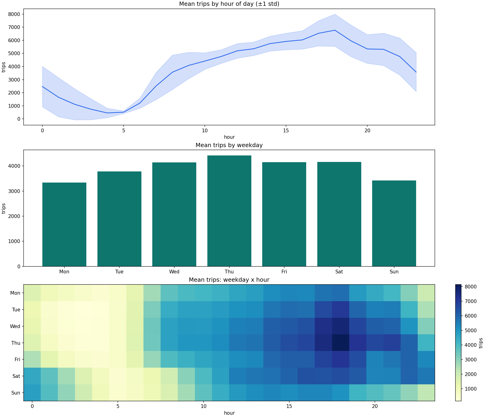

# 02_seasonality

## question

Is the weekend dip large enough to carry day-of-week in the forecast?

## decision — no_action

- metric: weekend_weekday_gap = 0.0438 [0.0034, 0.0895] 95% (n=2,183, unit=relative_gap)
- rule: max 0.1000 (permutation null 0.0558)
- action (timeseries): carry day-of-week in the forecast covariates

## evidence

- baseline: no weekend effect: weekend and weekday hourly demand are equal

### segments

| segment | value | n |
| --- | ---: | ---: |
| weekday_hours | 3,964.2179 | 1,560 |
| weekend_hours | 3,790.5024 | 623 |

### sensitivity

- weekend_over_weekday_ratio: 0.9560
- peak_hour_mean_trips: 6,767.5165
- trough_hour_mean_trips: 454.6593

### falsifier

the weekend-gap interval falls below the 10% effect floor

### provenance

- artifact: taxi_canonical.parquet
- source: data/processed/taxi_canonical.parquet
- seed: 42
- analysis_sample: 2183
- block: day
- resampling: block+block_shuffle
- exclusions: partial terminal hour excluded

## tables

- [hour_profile](02_seasonality_hour_profile.csv)
- [dow](02_seasonality_dow.csv)
- [hour_x_dow](02_seasonality_hour_x_dow.csv)
