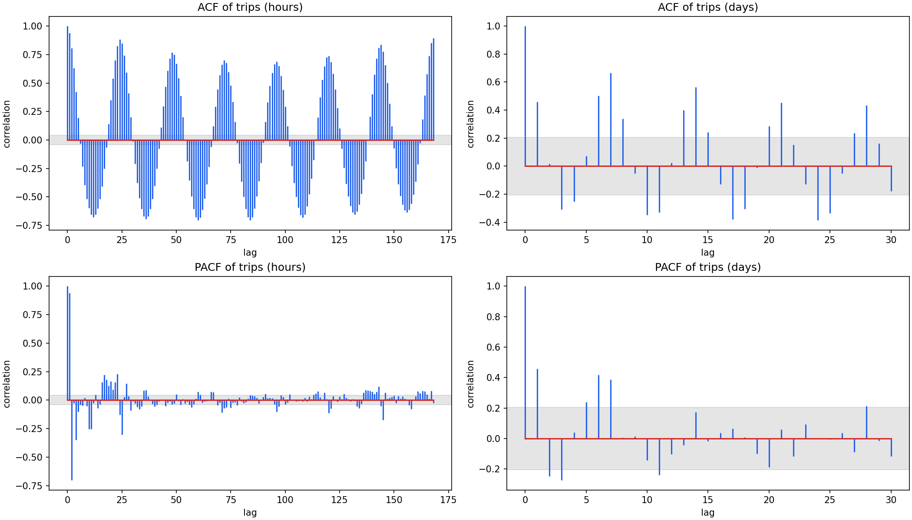

# 03_stationarity_acf

## question

Is the 24h autocorrelation strong enough for a seasonal-naive baseline?

## decision — investigate

- metric: hourly_acf_lag24 = 0.8816 [0.7482, 0.8816] 95% (n=2,183, unit=correlation)
- rule: max 0.8180 (permutation null 0.8180)
- action (timeseries): use the 24h seasonal-naive lag as the forecast baseline

## evidence

- baseline: no memory: autocorrelation at lag 24 is zero

### segments

| segment | value | n |
| --- | ---: | ---: |
| first_half | 0.8490 | 1,091 |
| second_half | 0.8808 | 1,092 |

### sensitivity

- daily_acf_lag_1: 0.4580
- hourly_acf_lag_1: 0.9416
- hourly_pacf_lag_24: -0.1292

### falsifier

the lag-24 autocorrelation interval falls below the 0.20 floor

### provenance

- artifact: 01_series_profile_hourly_counts.csv
- source: /home/opc/ONE/broad-way/project/experiments/results/timeseries/01_series_profile_hourly_counts.csv
- seed: 42
- analysis_sample: 2183
- block: day
- resampling: block+block_shuffle
- exclusions: partial terminal hour dropped

## tables

- [adf](03_stationarity_acf_adf.csv)
- [acf_hourly](03_stationarity_acf_acf_hourly.csv)
- [acf_daily](03_stationarity_acf_acf_daily.csv)
- [pacf_hourly](03_stationarity_acf_pacf_hourly.csv)
- [pacf_daily](03_stationarity_acf_pacf_daily.csv)
- [ccf](03_stationarity_acf_ccf.csv)
